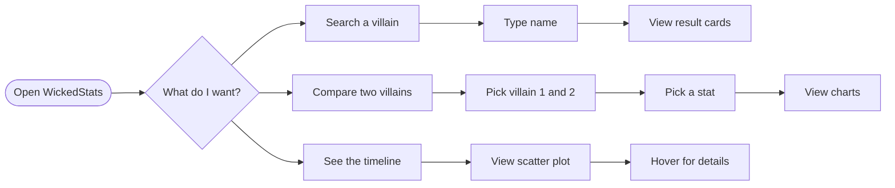

#  
 
### Explore, compare and chart your favourite comic-book villains

**Type of solution:** Frontend single-page web application (React) consuming a third-party REST API

**Built by:** [Khanyisile Manana] · [251301] · [Interactive Development(DV200)]

[](https://react.dev/)
[](https://www.chartjs.org/)
[](https://react-bootstrap.github.io/)
[](https://rapidapi.com/)


</div>

---

## Table of Contents

1. [About the Project](#about-the-project)
2. [Getting Started](#getting-started)
3. [Features](#features)
4. [Development Process](#development-process)
5. [Final Outcome](#final-outcome)
6. [Conclusion](#conclusion)
7. [License, Contact and Acknowledgements](#license)

---

## About the Project

WickedStats is a React data-visualisation app for comic-book villain fans. It pulls villain data from the Superhero Search API on RapidAPI and turns it into something you can explore: search any villain by name, compare two villains head-to-head on power, speed, strength and intelligence, and view a scatter-plot timeline of when villains first appeared in comics.

Charts are built with Chart.js, the interface with React Bootstrap, and the animated background with custom visual components. It is a frontend-only project that shows how to consume a third-party REST API, manage state with React hooks and present complex data clearly.

### Built With

| Area | Technology |
|---|---|
| Framework | React  |
| Routing | React Router  |
| Data fetching | `fetch` and Axios |
| Charts | Chart.js  and react-chartjs-2 |
| UI | React Bootstrap, CSS |
| Animation / visuals | Motion, Three based background (`ColorBends`, `LightPillar`), `BlurText` |
| Icons | Lucide React, React Icons |
| Data source | [Superhero Search API](https://rapidapi.com/) via RapidAPI |

---

## Getting Started

> **Frontend and backend:** WickedStats has **no custom backend**. Its "backend" is the third-party Superhero Search API hosted on RapidAPI. The setup steps below cover both the frontend app and getting access to that API.

### Prerequisites

- [Node.js](https://nodejs.org/) includes npm
- [Git](https://git-scm.com/)
- A free [RapidAPI](https://rapidapi.com/) account

### Installation

**1. Clone the repository**

```bash
git clone https://github.com/Khanyi20/wickedstats.git
cd wickedstats
```

**2. Install dependencies**

```bash
npm install
```

**3. Set up the API (backend) access**

1. Create or log in to [RapidAPI](https://rapidapi.com/) account
2. Search for **Superhero Search** and subscribe to the free plan
3. Copy your **X-RapidAPI-Key** from the API site
4. In the project path, create a file named `.env` and add:

```env
REACT_APP_RAPIDAPI_KEY=your_key_here
REACT_APP_RAPIDAPI_HOST=superhero-search.p.rapidapi.com
```

> ⚠️ `.env` files are for **local use only**. Never commit your key to GitHub. This project's `.gitignore` should list `.env`.

**4. Start the development server**

```bash
npm start
```

The app opens at [http://localhost:3000](http://localhost:3000).

**5. (Optional) Create a production build**

```bash
npm run build
```

### Available routes

| Route | Page |
|---|---|
| `/` | Home – search villains |
| `/comparison` | Compare two villains |
| `/timeline` | First-appearance timeline |

---

## Features

<!-- Add a screenshot or GIF for every feature. Suggested file names are shown. -->

### 1. Villain search
Type any villain name and get a roster of matching cards showing their image and four power stats.


### 2. Head-to-head comparison
Pick two villains from dropdowns, then see each villain's card and stat chart side by side, plus a bar chart comparing them on one selected stat (power, speed, strength or intelligence).


### 3. First-appearance timeline
A scatter plot of every villain's first comic appearance year. Hover over a dot to see the villain's name and year.


### 4. Animated, themed interface
An animated colour background, blur-in headline text and a custom logo and brand give the app its own identity.


### Feature summary

| Feature | Description |
|---|---|
| Search | Case-insensitive name search across all villains |
| Villain cards | Image and power stats from the API |
| Stat selector | Choose which stat drives the comparison chart |
| Comparison charts | Per-villain stat charts and a side-by-side bar chart |
| Timeline | Years extracted from biography data and sorted oldest to newest |
| About the API | Short explanation of where the data comes from |
| Responsive layout | [Confirm: works on mobile and desktop] |

---

## Development Process

### Planning and design

- **Idea:** [Why villains? = I wanted to make stats and charts fun and visual rather than a boring dashboard.]
- **Design:** Application was designed on Figma


### Architecture

The app is a single-page application. `App.js` sets up routing and a shared layout, each page is made of smaller reusable components, and every component that needs data calls the RapidAPI endpoint directly.

```mermaid
flowchart TD
    A[index.js] --> B[App.js<br/>BrowserRouter + Nav + ColorBends background]
    B --> C[Home page]
    B --> D[Comparison page]
    B --> E[Timeline page]
    C --> C1[SearchVillains]
    D --> D1[StatSelector<br/>two dropdowns]
    D --> D2[VillainCard]
    D --> D3[VillainCharts / VillainCharts2]
    D --> D4[ComparisonChart]
    E --> E1[TimeLineChart]
    C1 & D1 & E1 -->|fetch| F[(RapidAPI<br/>Superhero Search /api/villains)]
```

**Folder structure**

```
wickedstats/
├── public/             # index.html, icons, manifest
└── src/
    ├── pages/          # Home, Comparison, Timeline
    ├── components/     # SearchVillains, StatSelector, VillainCard,
    │                   # VillainCharts, ComparisonChart, TimeLineChart
    ├── component/      # ColorBends, LightPillar, BlurText (visual effects)
    ├── images/         # logo, brand name, wallpapers
    ├── App.js          # routes + layout
    └── index.js        # React entry point
```

### Data flow

```mermaid
sequenceDiagram
    participant U as User
    participant C as React component
    participant A as RapidAPI
    U->>C: Opens page / types a search
    C->>A: GET /api/villains (with API key header)
    A-->>C: JSON array of villains
    C->>C: Store in state (useState), filter / process data
    C-->>U: Cards and charts rendered
```

### User flow



### Key code snippets

**1. Search – filtering the API data in the browser**

```jsx
const handleSearch = () => {
  const filtered = villains.filter((villain) =>
    villain.name.toLowerCase().includes(searchTerm.toLowerCase())
  );
  setResults(filtered);   // lifts the results up to the Home page
};
```
*Why:* lowercasing both sides makes the search case-insensitive, and passing results up with `setResults` lets the Home page decide how to display them (lifting state up).

**2. Comparison – a bar chart driven by the selected stat**

```js
const data = {
  labels: [villain1.name, villain2.name],
  datasets: [{
    label: statsSelector,
    data: [
      villain1.powerstats[statsSelector],
      villain2.powerstats[statsSelector],
    ],
  }],
};
```
*Why:* using `powerstats[statsSelector]` means one chart component handles all four stats.

**3. Timeline – turning messy text into a year**

```jsx
const appearance = v?.biography?.firstAppearance;
const match = appearance.match(/\d{4}/);      // find a 4-digit year
const year = parseInt(match[0]);

return { x: year, y: index, name: v.name };   // a point on the scatter plot
// ...then .filter(Boolean).sort((a, b) => a.x - b.x)
```
*Why:* the API returns `firstAppearance` as free text (for example a comic title with a date), so a regular expression pulls out the year. Villains with no usable year are filtered out.

**4. Defensive rendering to avoid crashes**

```jsx
if (!villain) return null;                 // nothing selected yet
          // optional chaining for missing data
```

### Challenges and solutions

| Challenge | How I solved it |
|---|---|
| `firstAppearance` was inconsistent text, not a clean year | Used a regex to extract a 4-digit year and filtered out entries without one |
| Components crashed before a villain was selected | Added early returns (`if (!villain) return null`) and optional chaining |
| Needing the same API data in several components | [Explain – e.g. each component fetches what it needs; future improvement is a shared data layer] |
| Keeping my API key safe | Moved the key to an environment variable (`.env`) so it is not committed to GitHub |
| [Add your own, e.g. Chart.js registration errors] | [How you fixed it] |
| [Add your own, e.g. debugging with AI help] | [What the error was and what you learned] |

### Testing

| # | Test | Expected result | Pass |
|---|---|---|---|
| 1 | Search for a known villain (e.g. "Joker") | Matching card(s) with image and stats | ☐ |
| 2 | Search in UPPER and lower case | Same results | ☐ |
| 3 | Search for a name that doesn't exist | Empty-state message, no crash | ☐ |
| 4 | Choose two villains on the Comparison page | Two cards, two stat charts and a bar chart appear | ☐ |
| 5 | Change the selected stat | Comparison chart updates | ☐ |
| 6 | Open `/timeline` | Scatter plot loads, tooltip shows name and year | ☐ |
| 7 | Navigate with the top navigation | Routes change without a page reload | ☐ |
| 8 | Use a wrong or missing API key | [Describe what happens, then consider adding an error message] | ☐ |
| 9 | Resize to a phone width | Layout stays readable | ☐ |

---

## Final Outcome

### Demo video

<!-- Upload the video to YouTube (Unlisted) or Google Drive and paste the link here. -->
<!-- Remove the .mp4 from public/ - large videos should not live in the repo. -->

[](https://[YOUR-VIDEO-LINK])

▶️ **[Watch the 5–8 minute demo video](https://[YOUR-VIDEO-LINK])**

---

## Conclusion

### Highlights

- Turned API data into three different, interactive views (search, comparison, timeline)
- Used Chart.js with React to build bar and scatter charts
- Practised reusable components, state lifting and React Router
- Built a distinctive visual identity with a custom logo, brand and animated background

### What I learned

- How to authenticate with and consume a REST API (headers, async/await, error handling)
- How to clean unpredictable real-world data before charting it
- How to match the designs to the theme of the website

### Future improvements

- Add loading spinners and friendly error messages for failed API calls
- Add a backend proxy so the API key is never exposed in the browser
- Add pagination or filters (universe, alignment)
- Make the timeline show more than the first-appearance year

---

<!-- ## License

Distributed under the **MIT License**. See [`LICENSE`](LICENSE) for details. -->
<!-- Add a LICENSE file on GitHub: Add file → Create new file → name it LICENSE → "Choose a license template" --> 

## Contact

**[Khanyisile Manana]**
- Email: khanyimanana567@gmail.com
- GitHub: [@Khanyi20](https://github.com/Khanyi20)


## Acknowledgements

| Resource | Used for |
|---|---|
| [Superhero Search API (RapidAPI)](https://rapidapi.com/) | All villain data and images |
| [Create React App](https://create-react-app.dev/) | Project setup |
| [React](https://react.dev/), [React Router](https://reactrouter.com/) | Framework and routing |
| [Chart.js](https://www.chartjs.org/) and [react-chartjs-2](https://react-chartjs-2.js.org/) | Charts |
| [React Bootstrap](https://react-bootstrap.github.io/) | Layout and cards |
| [Lucide](https://lucide.dev/), [React Icons](https://react-icons.github.io/react-icons/) | Icons |
| [ColorBends / LightPillar / BlurText – confirm the source, e.g. React Bits](https://reactbits.dev/) | Animated background and text components |
| [Shields.io](https://shields.io/), [Mermaid](https://mermaid.js.org/) | Badges and diagrams in this README |
| **Claude (Anthropic)** | AI assistant used to help explain concepts, debug errors and structure this README. All code was reviewed and understood by me. |
| [Figma / Adobe tools – list what you used] | Logo, brand name and wallpapers |

<p align="right"><a href="#">⬆ Back to top</a></p>
